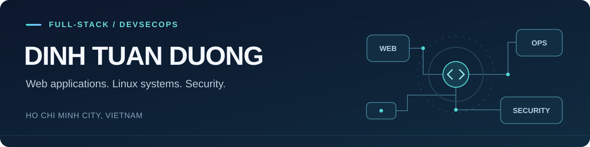
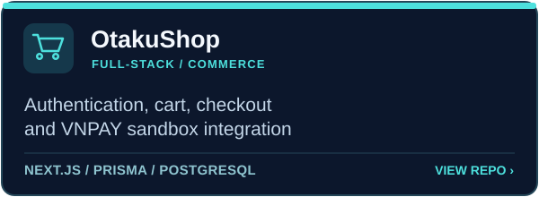
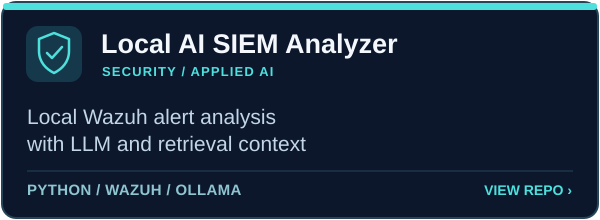
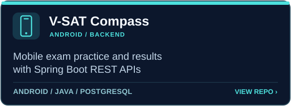
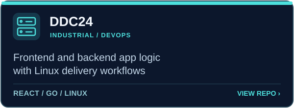

  

  <a href="./README.md">English</a> · <strong>Tiếng Việt</strong> · <a href="./README.ja.md">日本語</a>

  

  TP. Hồ Chí Minh, Việt Nam · Sẵn sàng làm việc từ xa và chuyển nơi ở để làm việc 
  <a href="https://www.linkedin.com/in/tu%E1%BA%A5n-d%C6%B0%C6%A1ng-%C4%91inh-965011285/">LinkedIn</a> · <a href="mailto:tuanduongdinh2004@gmail.com">Email</a> · <a href="https://github.com/haizzdungnay?tab=repositories">Các repository</a>

## Giới thiệu

Mình là **Đinh Tuấn Dương**, sinh viên ngành An toàn thông tin tại PTIT, định hướng **phát triển Full-stack và DevSecOps**. Mình phát triển giao diện web, logic backend và quy trình triển khai, với kinh nghiệm làm phần mềm công nghiệp tại Mekong Technologies và thực tập SOC tại HPT Vietnam.

Các dự án của mình trải rộng từ IoT công nghiệp, dịch vụ Linux và AI hỗ trợ phân tích bảo mật đến ứng dụng web/mobile. Mình chú trọng mã nguồn dễ hiểu, quy trình triển khai có thể tái lập và tích hợp kiểm tra bảo mật vào công việc phát triển hằng ngày.

## Kinh nghiệm

**Mekong Technologies — Công ty Cổ phần Công nghệ Mekong**  
**Full-Stack Engineer**  
*05/2026 – 09/2026 · Thực tập: 05–06/2026 · Nhân viên chính thức: 07–09/2026*

- **DDC24:** phát triển frontend, logic ứng dụng backend và phụ trách công việc DevOps cho bộ điều khiển BMS biên chạy trên Linux. Công nghệ dự án: React/TypeScript, Go, GitHub Actions, CMake và systemd.
- **MK200:** tập trung reverse engineering, khôi phục mã nguồn, kiểm thử bảo mật và kiểm thử chức năng của nền tảng IoT gateway/BMS/SCADA. Phân tích các thành phần đang chạy, đối chiếu giao diện Python/Cython được khôi phục với mã nguồn phiên bản trước.

**HPT Vietnam — Thực tập sinh SOC Tier 1**  
*10/2025 – 12/2025*

- Giám sát và phân loại cảnh báo trên Elastic SIEM; phân tích Windows Event Log, Syslog và lưu lượng mạng.
- Tương quan bằng chứng, ánh xạ hành vi theo MITRE ATT&CK và lập báo cáo để chuyển cấp xử lý sự cố.

## Dự án kỹ thuật nổi bật

Bốn dự án đại diện cho năng lực Full-Stack, Security Engineering, Android/backend và phần mềm công nghiệp. Mỗi bài phân tích liên kết với mã nguồn hoặc tài liệu công khai, nêu rõ đóng góp cá nhân và giới hạn kiểm chứng.

  
  

  
  

 

<strong>Đóng góp và mã nguồn các dự án</strong>

| Dự án | Phần mình thực hiện | Công nghệ |
| :--- | :--- | :--- |
| **[DDC24](https://github.com/haizzdungnay/DDC24)** · Mekong | Frontend, logic backend và DevOps cho bộ điều khiển công nghiệp. | React, TypeScript, Go, Linux, GitHub Actions |
| **[MK200](https://github.com/haizzdungnay/MK200)** · Mekong | Reverse engineering, khôi phục source, kiểm thử bảo mật và chức năng. Repo liên kết chứa bản mã nguồn được khôi phục một phần. | Python, FastAPI, Cython, Docker, PostgreSQL/TimescaleDB |
| **[Local AI SIEM Analyzer](https://github.com/haizzdungnay/local-ai-siem-analyzer)** | Triển khai toàn bộ trợ lý AI cục bộ diễn giải cảnh báo Wazuh, kết hợp LLM với truy xuất thông tin rule/MITRE. | Python, Flask, Wazuh, Ollama, ChromaDB |
| **[V-SAT Compass](https://github.com/haizzdungnay/VSAT_COMPASS)** | Triển khai toàn bộ ứng dụng Android và backend phục vụ luyện thi, quy trình quản lý câu hỏi và kết quả học viên. | Java, Android, Spring Boot, PostgreSQL |
| **[VNA Đắk Song](https://github.com/haizzdungnay/VNA_Chat-Bot-for-Dak-Song-prv)** | Triển khai toàn bộ web/Zalo Mini App du lịch, công cụ quản trị và các phần tích hợp backend. | React, TypeScript, Zalo Mini App, Cloudflare Workers/D1 |
| **[OtakuShop](https://github.com/haizzdungnay/WebSiteOtakuShopVer2)** | Triển khai toàn bộ ứng dụng thương mại điện tử: xác thực, phân quyền, đặt hàng và tích hợp VNPAY sandbox. | Next.js, TypeScript, Prisma, PostgreSQL |

Một số dự án được tổ chức theo nhóm hoặc trong môi trường học thuật. Phần việc mình trực tiếp đảm nhiệm được mô tả theo từng dự án; đồng thời giữ nguyên ghi nhận các thành viên tham gia. Các bài phân tích kỹ thuật tách biệt vai trò cá nhân, chức năng toàn hệ thống và minh chứng công khai.

## Công nghệ và kỹ năng

  

 

- **Frontend và mobile:** React, TypeScript, Next.js, Android/Java.
- **Backend và dữ liệu:** Python/FastAPI, Go, Node.js/NestJS, Java/Spring Boot; PostgreSQL, TimescaleDB, SQLite, Redis và Prisma.
- **DevOps:** Linux, Docker/Compose, Nginx, systemd, GitHub Actions, tự động hóa build/test và kiểm tra bảo mật trong CI.
- **Bảo mật:** Elastic SIEM, Wazuh, phân tích log, MITRE ATT&CK, Burp Suite, kiểm thử web theo OWASP, Wireshark và Nmap.
- **AI ứng dụng:** tích hợp LLM local bằng Ollama, RAG với ChromaDB, các dự án phân loại lưu lượng mạng.

## 🐍 Biểu đồ đóng góp

  <picture>
    <source media="(prefers-color-scheme: dark)" srcset="./dist/snake-dark.svg" />
    <source media="(prefers-color-scheme: light)" srcset="./dist/snake.svg" />
    
  </picture>

## 📊 Thống kê GitHub

  
  

  
  

## Học vấn và hoạt động

**Học viện Công nghệ Bưu chính Viễn thông (PTIT), cơ sở TP. Hồ Chí Minh**  
Ngành An toàn thông tin · 2022–2027 (dự kiến tốt nghiệp)

**CLB Công nghệ Thông tin Đa phương tiện (ITMC) — Co-Leader, 2022–2025**  
Điều phối hoạt động, workshop và chương trình onboarding; hướng dẫn thành viên mới.

<strong>Thành tích, đào tạo và ngoại ngữ</strong>

- Huy chương Vàng — ICPC PTIT HCM, 2023.
- Top 18 AIoT Developer — InnoWorks, 2025.
- SOC Tier 1 — IT Lab Thủ Đức, 2025.
- Google Foundations of Cybersecurity — Coursera, 2024.
- Advantech WISE-PaaS Core I & II và Developer I & II, 2025.
- Tiếng Việt: bản ngữ · Tiếng Anh: TOEIC 650 · Tiếng Nhật: cơ bản.

---

Quan tâm các cơ hội Full-stack và DevSecOps. **[Liên hệ với mình](mailto:tuanduongdinh2004@gmail.com).**
